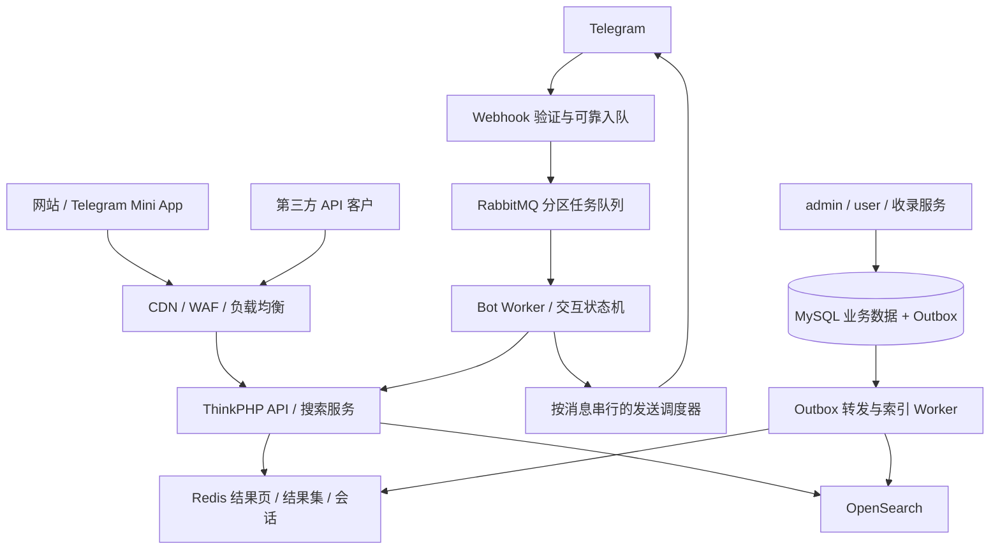

# Telegram 搜索系统架构建议

调研日期：2026-11-16，Asia/Shanghai。技术约束：ThinkPHP 8，admin / index / api / user 四个应用，MySQL 8.0 兼容基线，并持续验证后续版本。

本文件是方案，不是性能测试报告。当前仓库没有业务代码；本次没有安装框架、部署服务或对第三方机器人做压力测试。

推荐采用：**ThinkPHP 8 模块化业务代码 + 独立部署的 API / Bot Worker + MySQL 业务主库 + OpenSearch 检索集群 + Redis 缓存与短期状态 + RabbitMQ 可靠任务队列**。高频交互同时提供网页 / Telegram Mini App。是否能实现指定吞吐，以真实数据、查询分布和故障条件下的验收为准。

## 1. 已确认的机器人行为

入口：[SOSO搜搜的 Telegram Web 会话](https://web.telegram.org/a/#7049796554)。经用户授权，发送了一次通用关键词 `Python`，操作了普通搜索按钮和菜单。

| 范围 | 实际看到或验证的行为 | 对新系统的影响 |
| --- | --- | --- |
| 首页 | 搜索、热搜、发现、群频道榜、我的、帮助、赚钱，以及添加到群/频道入口 | 需要搜索、资源目录、运营、用户中心等独立业务模块 |
| 关键词搜索 | `Python` 返回混合类型结果，页面显示 1810 条、86 页 | 资源需要统一检索字段和类型，不能只建立一张群组表 |
| 翻页 | 点击下一页显示第 2 页，上一页返回第 1 页；原结果消息被更新 | 要管理消息 ID、搜索会话、页码和乱序回调 |
| 类型筛选 | 群组、频道、视频；展开后还有全部、音乐、图文、其它、店铺 | 筛选必须成为查询与缓存标识的一部分 |
| 分类切换 | 切换“频道”后显示 3 条、第 1 页、共 1 页 | 切换筛选应创建新的查询状态并重置页码 |
| 时间筛选 | 看到日期不限、近 3 天、近 7 天、近 30 天按钮 | 索引需要时间字段；时间范围在一次搜索会话中固定 |
| 结果展示 | 标题链接、类型图标，部分群/频道显示人数 | 索引或展示缓存需要完整的结果卡片字段 |
| 广告 | 翻页、切换按钮时赞助内容有变化 | 自然结果缓存、广告选择和曝光计数应分离 |
| 发现 | 分类导航、精选群/频道、新收录入口 | 目录和推荐榜适合预计算，不能每次点击执行大聚合 |
| 我的 | 营销中心、充值、邀请、增长台、群组管理、频道管理；提现指向小程序审核 | 用户业务与高频检索分开；资金业务需要事务和幂等 |
| 搜索教程 | 说明私聊搜索、聊天内 inline 搜索、群内搜索、链接查询收录状态 | 接入层可扩展，核心搜索服务应复用 |
| 收录教程 | 公开链接、添加机器人为管理员、提交审核；频道可以申请内容收录 | 需要收录、审核、增量更新、下架和索引同步链路 |

本次未验证日期筛选的具体结果、群内搜索、inline 搜索、真实收录、支付、推广结算及管理权限。首页用户规模和“0.5 秒”等文字只是页面展示，不能据此认定真实并发、后端实现或响应时间。界面上出现的总结果数也不用于反推固定每页条数。

## 2. 明确负载与平台边界

暂按 **1000 万条可检索资源，30 万同时活跃用户** 设计。若“千万级”指注册用户，用户表和身份系统的容量需要单独补充，不能替代资源规模指标。

| 情景 | 估算方法 | 用户操作速率 |
| --- | --- | --- |
| 30 万用户在线，不点击 | 在线人数不等于请求数 | 不能直接推算 RPS |
| 30 万人平均每 10 秒操作一次 | 300000 / 10 | 30000 次/秒 |
| 30 万人平均每 6 秒操作一次 | 300000 / 6 | 50000 次/秒 |
| 30 万人在 1 秒内各操作一次 | 300000 / 1 | 300000 次/秒突发 |

以上是业务事件速率，尚未乘上每次操作的缓存读写、搜索查询、回调确认和消息编辑次数。不能把 30 万在线用户配置成 30 万个 PHP 进程。以自有 API 平均处理时间 200ms 为例，50000 RPS 对应约 10000 个在途请求，这是估算关系，并非实测能力。

需要分别验收：用户点击、Telegram 投递、Webhook 接收、自有服务计算、Telegram 接受消息操作、客户端呈现。它们不是一个指标。

Telegram 官方对单聊天发送消息、群消息和群发分别给出限流说明；免费群发约 30 条/秒，付费广播有相应的更高额度。这些是**消息发送/广播规则**，不能直接当作所有编辑消息、callback 或入站更新的统一 QPS，也不能据此保证这些方法无限吞吐。[官方 Bots FAQ](https://core.telegram.org/bots/faq#my-bot-is-hitting-limits-how-do-i-avoid-this)

云端 Webhook 的同时连接数上限为 100，它是连接数而非每秒请求数；自建 Bot API Server 可以提高 Webhook 连接配置，但这不构成对 Telegram 服务端消息或反滥用限流的豁免。[官方 Bot API](https://core.telegram.org/bots/api#setwebhook)、[本地 Bot API Server](https://core.telegram.org/bots/api#using-a-local-bot-api-server)

因此，推荐保留聊天搜索与按钮，同时把连续浏览、复杂筛选、深翻页放在网站或 Mini App 内，通过 HTTPS 直接访问自己的 API。不要为每次网页翻页再发一条 Bot 消息。Mini App 登录数据须在服务端验证 `initData` 和时间有效性，不信任 `initDataUnsafe`。[官方 Mini Apps 文档](https://core.telegram.org/bots/webapps#validating-data-received-via-the-mini-app)

如果产品要求所有操作都留在单个 Bot 的聊天按钮中，应先用自有测试 Bot 测量方法级别的可用吞吐，并确定排队时限和降级体验，不能承诺几十万人同时点击后全部即时刷新。也不把创建大量 Bot 当成绕过平台约束的方案。

## 3. 应用、进程和数据职责

采用一个仓库、共享领域服务、按流量独立部署的方式。四应用满足产品组织；独立进程池和部署组提供资源隔离，二者不应混为一谈。

| 入口/组件 | 职责 | 部署与权限 |
| --- | --- | --- |
| `admin` | 资源审核、分类、词库、广告、用户/API 客户管理、审计、运营配置 | 独立域名、管理认证和进程池；公众域名不能通过切换路径进入管理应用 |
| `index` | 网站展示、SEO 资源页、网页搜索、Mini App 页面 | 静态内容/CDN；动态检索调用统一搜索服务 |
| `user` | 登录、收藏、我的资源、收录申请、推广、余额与订单（若纳入产品） | 与管理端分离的会话、权限与连接配额 |
| `api` | `/v1` 搜索与资源接口、API 鉴权、Telegram Webhook | 公共 API、内部 Bot 接入使用不同凭据、配额和部署组 |
| Bot Worker | 消息解析、回调状态、消息渲染、限流发送 | CLI 常驻工作进程；不运行在长时间占用的 HTTP 请求中 |
| 索引 Worker | 消费资源变更、批量更新 OpenSearch、重试与对账 | 与搜索和 Bot 回复独立扩缩容 |
| 统计 Worker | 搜索/点击/展示聚合、榜单计算、归档 | 不阻塞用户交互；明细日志按保留期归档 |

代码建议：四个应用的 Controller 只做协议转换、鉴权、校验；共享 `SearchService`、`ResourceService`、`SubmissionService`、`InteractionService`、`PromotionService` 等业务服务，底层经 Repository / Adapter 访问数据库、检索、缓存和 Telegram。Bot Worker 直接复用服务接口，不绕回自己的公网 Controller。

HTTP 首期可使用 Nginx + PHP-FPM，开启 OPcache；Bot 和索引使用受进程管理器监管的 CLI Worker。对高频 API 可以评估官方 `think-swoole` 常驻部署，但必须验证请求上下文隔离、连接池、超时、内存回收和依赖兼容性。常驻运行减少框架初始化开销，不能代替缓存、限流和正确查询设计。官方项目提供 TP8 多应用支持，`think-swoole` 的兼容范围需锁定具体版本后测试。[多应用扩展](https://github.com/top-think/think-multi-app/releases)、[think-swoole 依赖声明](https://github.com/top-think/think-swoole/blob/4.0/composer.json)

MySQL 是业务事实来源；OpenSearch 是可重建的检索视图；Redis 中的搜索状态可过期；RabbitMQ 保存待处理任务。资金和资源权限不能只存在缓存里。图中省略了非搜索业务经领域服务读写 MySQL 的路径。

## 4. 千万资源的检索与同步

不把 `LIKE '%关键词%'`、大 OFFSET、逐条 ORM 查询组合成主搜索链路。选择 **OpenSearch 作为唯一主检索引擎**，MySQL 保留事务、主数据和管理查询。

建议检索文档包含：`resource_id`、资源类型、标题、简介/正文、标签、标准化用户名、链接、来源 chat/message 标识、语言、发布时间、人数、质量分、状态、可见范围、版本号。

- 标题、正文建立全文字段；类型、状态、语言、权限和精确用户名使用适当的 keyword/数值字段；时间使用日期字段。
- 中文先建立 CJK / ICU 基线，用真实中英文混合词、短词、繁简体、用户名、链接和拼写变体评估召回与准确率。分词选择看样本，不默认第三方插件天然适配所有引擎版本。[OpenSearch CJK 文档](https://docs.opensearch.org/latest/analyzers/language-analyzers/cjk/)
- 初始排序建议：精确用户名/标题匹配优先，结合文本相关性、审核质量和有上限的热度；不让成员数量完全压过相关性。所有排序最后加入唯一 `resource_id` 的可排序字段。
- 自然结果与广告分离。混合类型需要定义固定的合并顺序和去重规则，不能在不同页重新随机混排自然结果。
- 一页结果需要的展示字段放进索引或批量展示缓存，避免返回 20 条结果就回 MySQL 查 20 次；详情另走单独缓存/读接口。
- 禁止客户端直接提交 OpenSearch DSL。限制关键词长度、分页条数、模糊扩展、正则、通配符和高成本聚合。

写入流程：业务事务同时写资源变更和 Outbox → 转发器可靠发布 → 索引 Worker 批量写入 → 记录处理进度和失败 → 定期比对/补偿。采用至少一次投递，因此索引更新必须按资源 ID 和单调版本幂等，删除/撤回事件也要防止旧事件把内容恢复。

Outbox 的标记必须发生在可靠发布确认之后，不能在业务事务里直接“写 MySQL 成功再尝试写搜索”并忽略中途失败。数据量与采集吞吐增长后，可评估 binlog CDC；首版不同时引入多条权威同步路径。

索引采用版本化名称和读别名；重建时全量扫描、追平增量并验证后切换别名。旧搜索快照在规定有效期内结束后再回收旧索引。普通更新允许秒级最终一致；封禁、权限撤销和紧急下架在返回结果前叠加最新状态校验，不能等缓存自然过期。

数据来源必须有独立接入计划：公开资源提交、经授权加入的群/频道更新、管理导入等。不能把 Bot API 理解为可以任意搜索全 Telegram、读取所有历史消息的接口。群权限和隐私模式影响可接收消息，历史补录能力需要逐个来源确认。[Telegram 可接收消息范围](https://core.telegram.org/bots/faq#what-messages-will-my-bot-get)

## 5. 翻页设计：共享结果集、游标和独立会话

高并发翻页的核心是复用结果，并固定一次搜索的视图，而不是把所有翻页重新转成昂贵检索。

**查询标识**至少包含：规范化关键词、资源类型、固定后的时间范围、每页条数、排序规则、语言、可见权限范围、排序版本、索引/快照代次。只有访问范围一致的公共结果才能共享；个性化结果必须增加相应作用域。相对日期基于共享快照代次的时间计算，避免每个请求使用不同的毫秒级当前时间，导致相同筛选无法复用缓存。

**结果集与用户会话分离**：

- `resultset_id` 关联一个查询视图，缓存已经生成的结果页和页面游标，可由多个用户共享。
- `session_id` 仅保存用户、Bot、chat、message、结果集、已显示页、期望页、版本和到期时间等小数据。
- 不为 30 万用户各复制一份完整资源正文，也不让所有用户共用一个可变“当前页”。

**推荐分页方法**：

1. 初次搜索返回一页，例如 20 条，必要时多取 1 条判断是否还有下一页；不要为每个冷门词预读数千条。
2. 已缓存的下一页/上一页直接读结果集缓存；缓存未命中才访问检索引擎。
3. 下一页使用上一页末条的完整排序值做 `search_after`。保持相同查询、过滤和排序，并包含唯一排序字段作最终决胜条件。
4. 上一页优先使用缓存，或使用已记录的“该页开始前游标”重新生成；`search_after` 本身不会自动提供上一页或任意跳页功能。
5. 一次搜索用 PIT 固定索引视图，固定相对日期的计算基准和排序中的时间基准，避免刷新索引后重复、漏项或顺序漂移。
6. 切换筛选创建新结果集引用、增加交互版本并回到第 1 页。会话/PIT 过期时明确提示重新搜索，不能悄悄换到另一批结果继续旧页码。

深度 `from + size` 会增加各分片排序与合并成本；OpenSearch 默认窗口是 10000。官方推荐 PIT 配合 `search_after` 实现一致分页，而不是简单调大窗口。[分页文档](https://docs.opensearch.org/latest/search-plugins/searching-data/paginate/)

**PIT 数量也必须受控**。不按用户建立 30 万个长期 PIT。可按索引集合和时间段建立小规模、有上限的共享 PIT 池，服务端管理句柄，多个查询引用同一快照；查询仍必须独立带权限过滤。PIT 可以承载不同查询，这是共享设计的依据，但其生命周期、节点失败和并发使用仍需在选定版本验收。[PIT 文档](https://docs.opensearch.org/latest/search-plugins/point-in-time/)

可作为首轮压测参数：每 30 秒建立新快照代次、绝对有效期 5 分钟、每个索引集合最多约 10–12 个活动代次。具体数量以文件句柄、旧 segment 保留、磁盘增长和更新率为依据；不能无限续期。结果集与会话 TTL 不得超过其底层快照的实际有效期。句柄失效要终止该会话的继续检索。

首版可限制每会话最多浏览 100 页，超出提示缩小关键词或筛选；需要全量导出的客户走独立配额的异步导出任务。是否显示总页数单独定义：小结果集可以给精确总数，大结果集使用有阈值的计数与 `eq/gte` 标志，展示“10000+”和“还有更多”，不在每次翻页重新精确统计全量匹配。

缓存分为：短期进程内热点页、Redis 共享结果页、Redis 独立会话状态。结果页和热门榜可用短 TTL 加随机抖动、按需预取一页、同查询同页合并加载。不同用户请求同一个未命中页面时，只让一个构建者访问搜索；等待有上限，超时返回明确的重试结果。

Redis Cluster 不能自动把一个热点 key 拆到多台机器。极热公共页面通过各应用节点的短期只读副本分散读取；动态会话和鉴权状态仍走正确的权威检查。缓存故障时限制回源并降级，不能把所有流量转给 MySQL 或无上限地压向 OpenSearch。

## 6. Telegram 回调的可靠性与并发控制

接入流程：验证 Webhook → 解析与限制请求体 → 发布可靠队列并获得确认 → 返回 HTTP 2xx；然后由高优先级 Worker 尽快确认 callback，业务 Worker 计算结果，发送调度器编辑消息。Webhook 配置独立 secret 并校验 `X-Telegram-Bot-Api-Secret-Token`；Bot token 不出现在公开回调路径、客户端或访问日志中。HTTP 2xx 不等于 `answerCallbackQuery`，后者负责结束客户端按钮的等待状态。[CallbackQuery 文档](https://core.telegram.org/bots/api#callbackquery)

不要在消息尚未可靠入队时先返回成功。也不要先在 Redis 标记“已经处理”，再入队；这两个操作之间宕机会导致重试被误丢弃。可允许重复入队，在消费端幂等处理。RabbitMQ 使用 quorum queue、publisher confirms 和消费手动确认，业务仍按至少一次交付设计。[RabbitMQ Quorum Queues](https://www.rabbitmq.com/docs/quorum-queues)

交互路径需要以下规则：

| 风险 | 处理方式 |
| --- | --- |
| Webhook 重投 | 用 `(bot_id, update_id)` 标识更新；持久业务另有事务级幂等键 |
| 同一按钮连点 | 按来源版本和绝对目标页幂等，不使用无条件 `page++` |
| 上一页/下一页/筛选交错 | 版本比较与原子状态更新，旧版本动作不能覆盖新查询 |
| 多 Worker 同时编辑同一消息 | 按 `(bot_id, chat_id, message_id)` 分片，同一消息最多一个在途编辑 |
| 已过时编辑排在队列里 | 发送前核对最新期望版本，合并尚未发送的中间状态，只发送当前目标 |
| 编辑请求超时，结果不确定 | 记录期望状态，有限重试或后续纠正；不声称拥有 Telegram 端的恰好一次语义 |
| 群内别人点击搜索按钮 | 校验搜索会话拥有者；公共共享会话要有明确规则，不能被任意用户改写 |
| callback 过期 | 不无限重试，返回重新搜索入口；会话状态丢失也按同样方式恢复 |
| Telegram 返回 429 | 按返回的 `retry_after` 延迟调度，分别控制 Bot、聊天和方法预算 |

仅在编辑之前比较一次版本号是不够的：两个已发出的请求仍可能以相反顺序完成，必须限制同一消息的在途编辑数量。不同消息并行执行，不能对整个 Bot 上一把全局业务锁。

按钮数据使用不透明会话 ID、动作/目标页、版本和校验码，详细查询保存在服务端；同时校验操作者和会话绑定。Telegram 的 `callback_data` 限制为 1–64 字节，需要按最终 UTF-8 字节数检测，不能塞完整关键词、筛选 JSON 或 PIT。[InlineKeyboardButton 文档](https://core.telegram.org/bots/api#inlinekeyboardbutton)

队列按固定数量的分区扩展，不为每个用户建队列。交互确认、搜索回复、索引更新、统计和广播使用独立预算，避免导入或群发堵住交互。应监控最老任务年龄并设截止时间；长期到达速率高于消费速率时，队列只会越来越长，必须限流、合并、拒绝或引导网页，不能靠增加队列长度解决。

余额、购买、充值通知等持久业务不使用“只保留最后一次”策略。它们需要 MySQL 事务、唯一业务单号和独立幂等，且不能与可丢弃的页面刷新任务混为一类。

## 7. MySQL 模型与向上兼容

按业务领域设计表，而不是四个应用各复制一套表。首批表组建议：

| 表组 | 内容与关键设计 |
| --- | --- |
| 身份 | 用户、Telegram 身份绑定、管理用户、角色权限、API 客户与密钥摘要 |
| 资源 | 群/频道主数据、统一资源、内容扩展、分类标签、资源状态和版本 |
| 收录 | 申请、审核记录、来源接入、同步进度、抓取/更新失败任务 |
| 用户关系 | 收藏、资源归属、管理权限、举报 |
| 运营 | 广告计划、投放位置、推广关系、版本化配置 |
| 资金（若实现） | 订单、账本、支付回调、结算；金额使用 DECIMAL 和幂等业务键 |
| 可靠同步 | Outbox、关键任务幂等、必要的处理进度 |
| 统计 | 小型聚合表、审计；原始海量事件独立归档或进入后续分析存储 |

Telegram chat ID 使用有符号 BIGINT，消息 ID 与所属 chat 组合唯一，不能假设 message ID 全站唯一。内部资源 ID 采用 BIGINT，并在对外 JSON 中统一按字符串输出，避免以后使用较大 ID 时出现客户端精度问题。

千万行不意味着必须立刻分库分表。先做合适的联合索引、窄行/大正文分离、按访问模式查询、限制连接总量及独立统计负载。业务主库部署高可用和备份；读副本用于可以接受延迟的业务读取，资金、刚写完的关键状态读主库或采用明确的一致性机制。

搜索和翻页不逐次写 MySQL 点击计数，不每次查询数据库加载所有系统配置。事件批量聚合；真实资金与业务提交不能为了性能改成不可靠的内存计数。按时间归档审计和统计事件，避免日志比资源表更早成为瓶颈。

兼容策略：

- 使用 InnoDB、utf8mb4、明确的字符排序规则、严格 SQL 模式和参数化查询；基线锁定到具体 MySQL 8.0 补丁版本。
- 使用支持 `caching_sha2_password` 的 PDO/mysqlnd 客户端和 TLS，不依赖旧认证插件。`mysql_native_password` 在 8.4 默认禁用，在 9.0 移除。[认证变更](https://dev.mysql.com/doc/refman/8.4/en/native-pluggable-authentication.html)
- 避免新保留字、隐式类型转换、零日期、非确定 GROUP BY 和已废弃语法；所有结构变更使用可重放的迁移。
- 将“应用兼容”与“数据库物理升级路径”分开验证；升级前执行 MySQL Shell upgrade checker、备份恢复演练和实际业务回归。跨版本升级按官方支持路径逐段进行，不跳过中间 LTS。[升级准备](https://dev.mysql.com/doc/refman/9.7/en/upgrade-prerequisites.html)、[升级路径](https://dev.mysql.com/doc/refman/9.7/en/updating-yum-repo.html)

截至调研日期，官方标示 8.0 已于 2026-04-21 进入 Sustaining Support；当前 LTS 文档为 9.7，下载页展示的最新 Innovation 版本为 26.10.0。建议保持 8.0 应用兼容要求，但新生产部署优先评估维护中的 LTS；不未经确认替用户改变数据库约束。[官方生命周期公告](https://www.mysql.com/support/eol-notice.html)、[版本轨道](https://dev.mysql.com/doc/refman/9.7/en/mysql-releases.html)、[官方当前下载页](https://dev.mysql.com/downloads/mysql/)

当前建议的兼容验证矩阵：指定的 8.0.x、8.4.x LTS、9.7.x LTS、26.10.0。每次发布验证安装、迁移、关键读写、事务、索引和排序；未来新版加入矩阵后才声明支持。不能承诺尚未发布的所有 MySQL 版本无条件兼容。

## 8. 缓存、带宽、机器数量的估算方法

以 50000 次/秒读取操作为例，下面只计算一轮查询，不含重试、聚合和预取：

| 共享结果页缓存命中率 | 到达搜索引擎的逻辑查询量 |
| --- | --- |
| 95% | 2500 次/秒 |
| 80% | 10000 次/秒 |
| 0% | 50000 次/秒 |

因此，95% 命中只是需要验证的场景，不是容量保证。必须测试大量不同关键词、不同过滤条件、冷启动和过期潮。一次逻辑查询还可能扇出到多个分片，不能把它等同为一个分片上的工作量。

- 若每次操作产生 5 条 Redis 命令，则为约 25 万命令/秒，需要看热点分布、网络、脚本和每个分片的延迟；pipeline 可以减少往返，但不会消除服务器执行成本。
- 自有 HTTP 每次返回 20KB，50000 RPS 约为 1GB/秒，即 8Gbps 的响应有效载荷，尚未计入协议、复制和内部流量。网络容量与 JSON 大小要一起压测。
- 会话内存约为“活动会话数 × 每会话实际序列化大小”；结果缓存内存约为“不同结果集数 × 已缓存页数 × 单页实际大小”，再加 Redis 元数据、复制和余量。共享与否、冷门查询占比远比总用户数更关键。
- 索引容量先用具有代表性的样本实建：单文档实际主索引体积 × 资源数量 ×（1 + 副本数），再为合并、PIT 保留旧 segment、重建和增长留余量。不能只按正文原始大小买磁盘。

生产高可用的起始拓扑可以是：至少两个 API 实例和独立 Worker 池；MySQL 高可用主写服务及副本/备份；Redis 按负载选择主从或 3 主 3 副本 Cluster；RabbitMQ 3 节点、多个 quorum 队列；OpenSearch 至少 3 个数据节点并配置副本，高负载时独立部署 3 个 cluster-manager 节点。关键状态缓存与可淘汰结果缓存应有资源隔离，Redis 故障也不能影响业务事实恢复。

这只是高可用起点，**不是该配置可承受 50000 RPS 的结论**。OpenSearch 的主分片数量应根据索引体积、查询扇出、写入率和迁移策略确定；副本可以帮助读扩展，也带来写入与存储成本。应用实例数量用每实例在目标 p99 下的实测吞吐计算，并满足失去一个实例/节点后的容量要求。

示例公式：若每实例安全吞吐为 q，需要 N 满足 `(N - 1) × q >= 目标RPS × 1.3`，这里 30% 是示例余量。q 必须来自该业务与运行环境的测试，不能引用框架 Hello World 的 QPS。

## 9. 开放 API、故障与验收

API 设计建议：`/api/v1/search` 返回资源页、结果集标识、下一页游标、过期时间、计数准确性与请求 ID；随后通过签名游标继续查询。客户端不能任意修改页数、租户、权限范围或检索参数。

自用 Bot 和外部开发者共用领域能力，使用不同访问策略。默认不开放外部申请；开放后为每个客户配置读权限、速率、突发、日用量、最大页数、数据范围和审计。密钥保存摘要，支持撤销与轮换；API 配额不足返回 429 和重试提示。鉴权成功也不意味着可以访问所有资源。

| 故障/压力 | 预定行为 |
| --- | --- |
| 搜索集群变慢/不可用 | 允许范围内提供仍有效缓存，限制未命中查询；不回退到 MySQL 全文扫描 |
| 结果缓存失效 | 受控回源、合并同页构建、限制搜索并发；冷门请求可以明确拒绝 |
| 会话/PIT 丢失 | 告知重新搜索，不能错页或串号 |
| 队列没有多数派/无法确认发布 | Webhook 不虚假确认成功；监控重试与上游积压 |
| Telegram 429/超时 | 延迟调度、限制重试次数和任务年龄，丢弃过时页面刷新 |
| 资源撤回/权限变化 | 当前状态拦截旧缓存结果，异步清理索引和缓存 |
| 统计或广告服务故障 | 搜索主体按预定策略继续，广告可不展示；金额结算不能虚构成功 |

压测用自有服务和模拟 Telegram 出站端点制造主要负载；第三方实际 Bot API 仅在授权、可控速率下验证行为，不对参考机器人压测。

至少覆盖：1000 万代表性资源；热点与长尾查询；95%、80% 和低命中场景；关键词风暴；连续下一页/上一页/筛选；重复、乱序和延迟更新；冷热缓存；索引持续更新；一个节点故障；429、超时、连接池耗尽；过期 PIT；缓存与队列重启；撤权后的旧结果；计费请求重复投递。

建议首轮验收目标（待预算和实测收敛）：自有接口缓存命中 p95 ≤ 150ms，未命中检索 p95 ≤ 500ms；Webhook 自有处理 p95 ≤ 100ms，且可靠入队后才确认。对 1000 → 5000 → 10000 → 30000 → 50000 RPS 阶梯测试，并单独测一秒 30 万事件的突发接收与恢复。p99、错误率、最老任务年龄、实际消息更新耗时和压测机自身饱和情况一并报告。

Telegram 客户端最终刷新时间包含平台投递、出站限流和网络，不能拿上述自有服务目标对外承诺。用户状态不得串号、旧版本不得覆盖新状态、已确认的持久业务不得丢失，是独立于平均延迟的验收条件。

落地顺序：先确定资源来源、类型、权限与搜索结果契约；实现 ThinkPHP 四应用和完整收录—索引—检索链路；实现共享分页与 Bot 状态机；完成开放 API 和网页/Mini App 的接入；最后用数据和压测决定分片、节点数量、常驻 HTTP 运行时及进一步拆分服务。广告、资金和群治理按实际产品范围分期，不让它们阻塞搜索核心的容量验证。
