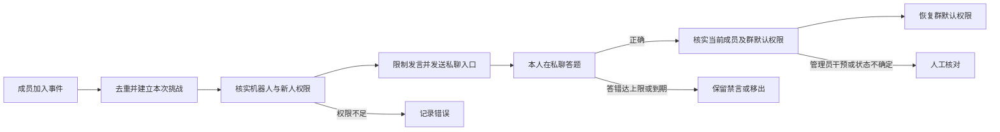
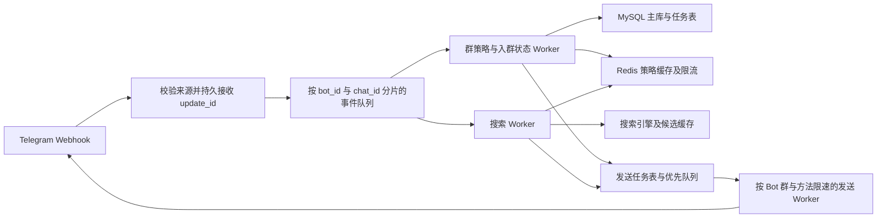

# 群管理、入群验证与随机搜索

更新日期：2026-11-19。后端：Go；数据库：MySQL 8；前端：Vue 3 + Element Plus。

## 本次实现

后台「机器人管理 → 群组安全」按群配置，新增字段沿用服务端 RBAC 字段权限。新规则默认关闭，数据库迁移不会主动给现有群开启删除、禁言或入群验证。

| 功能 | 行为 |
| --- | --- |
| 消息字数 | `message_max_chars=0` 关闭；1–4096 为上限。统计正文或媒体说明的 Unicode 字符数，超过上限才拦截。组合 emoji 可能包含多个 Unicode 字符。 |
| 静默拦截 | 超长、媒体、转发、链接、关键词和防刷规则先于搜索执行。命中后尝试删除，不回复搜索结果；删除失败也不会把该消息送入搜索，并记录错误。 |
| 管理员豁免 | 读取当前成员身份，群主、管理员不按普通成员规则删除。身份无法确认时保守处理。 |
| 新人验证 | 与搜索验证码独立；支持点击按钮、图片字母数字、四则运算、单个 emoji、顺序 emoji、随机方式。 |
| 验证位置 | 超级群中新人先禁言，群内按钮打开 Bot 私聊完成验证。机器人不能主动向从未开始私聊的人发送验证。 |
| 超时和失败 | 可选择保留禁言或移出群。移出模式限制 60 秒后允许重新加入；不会把重入当作旧验证成功。 |
| 欢迎语 | 开关、模板、14 种标签、字数统计、插入标签和预览。模板和用户提供的昵称、群名均安全转义。展开后限制长度，为验证提示保留空间。 |
| 随机搜索 | 新搜索等概率随机展示，翻页保留结果快照。点赞推荐已取消，历史点赞不影响排序。 |
| 随机展示 | 每次新搜索生成加权随机顺序；同次搜索的上一页、下一页复用快照。「换一组」重新抽取。 |

常用群命令：

```text
/groupsettings        查看本群设置和命令
/maxlength 100        超过 100 字的普通成员消息静默删除
/maxlength 0          关闭字数拦截
/joinverify emoji     新人使用 emoji 验证
/joinverify text      新人使用图片字母数字验证
/joinverify math      新人使用算数验证
/joinverify off       关闭新人验证
/welcome on           开启新人欢迎
/welcome off          关闭新人欢迎
/media on             拦截媒体
/forwards on          拦截转发
/ads on               开启链接拦截
/flood on             开启防刷屏
```

这些命令要求当前群主或管理员身份。删除需要删除消息权限；新人禁言验证需要超级群及限制成员权限。普通群仍支持搜索、欢迎和有权限的删消息；Telegram 的 `restrictChatMember` 只适用于超级群。

欢迎语示例：

```text
欢迎 {{mention}} 加入 {{chat_title}}！
昵称：{{nickname}}  用户名：{{username}}
用户 ID：{{user_id}}
当前时间：{{datetime}}（{{timezone}}）
请完成验证后参与交流。
```

其他标签：`first_name`、`last_name`、`chat_id`、`chat_username`、`bot_username`、`date`、`time`。标签取入群用户和当前群的上下文，不取邀请人；未知或残缺标签会拒绝保存。模板不支持任意 HTML。

## 入群验证的持久状态



`ts_bot_join_challenges` 保存群、用户、挑战随机 ID、消息代次、答案哈希、到期时间、尝试次数、权限归属和操作状态。`(bot_id,chat_id,user_id)` 唯一；另有挑战唯一索引及到期、操作租约索引。

`chat_member` 与 `new_chat_members` 可能描述同一次入群，不能发两遍欢迎或创建两份验证码。验证受用户、私聊、题目消息、当前挑战和到期时间约束；离群、重入、旧题目和其他人的按钮不会沿用旧授权。

普通消息及编辑消息先经过内容审核，再决定是否允许搜索。新人资格统一检查覆盖搜索入口、旧翻页/筛选/推荐按钮和旧搜索验证码恢复路径；待验证、失败、人工核对和离群状态均不能继续使用。检查只读数据库，不为每条消息调用 Telegram。没有挑战记录的存量成员正常使用；收到其他管理员明确恢复发言的成员事件后记录 `admin_released`，恢复搜索。关闭本群新人验证同样放开搜索，但不会自动解除 Telegram 上已存在的禁言。

权限恢复必须核实机器人自身权限、当前成员仍处于本次预期限制、该限制的成员事件确认，以及当前群默认权限。收到其他管理员修改限制的事件后，不自动解除其限制。网络结果不明确或进程在权限操作中断时，保守标记人工核对，后台群错误可见。Telegram 没有“比较后原子修改成员权限”的接口，因此最后一次读取和权限写入之间仍存在外部管理员同时修改的竞态；不要把它描述成绝对互斥的权限控制。

一个群管维护循环处理到期状态，每轮最多 50 个到期任务及 50 个过期操作租约，再等待 5 秒；不会为每位新人创建一个 goroutine 或定时器。任务状态在 MySQL 中，重启后仍可发现到期和未完成操作。HTTP 调用位于事务之外。当前轮询和成员处理仍是单 Bot 进程，下面的集群方案尚未启用。

## 随机排序与稳定翻页

点赞推荐功能已取消。机器人列表、网页卡片及详情、后台资源列表和权限编辑器均不再提供推荐计数或按钮。旧客户端的点赞及状态接口返回 HTTP 410；旧 Telegram 推荐按钮只提示功能已取消，不再写入数据。

保留既有 `ts_resource_likes` 和 `resources.like_count` 历史数据用于回退，业务查询不返回该字段，新搜索不读取或使用点赞数。历史角色中的该字段授权不再生效，编辑角色时不再回显。删除用户时，历史点赞不再构成业务阻拦，依现有外键级联清理。

新搜索为每个候选按本次随机种子和资源 ID 生成均匀随机分数，按分数升序取样。所有候选机会相同。同一次搜索保存候选 ID 顺序两小时，新搜索重新抽取，不打乱已打开页面的顺序；更新前的快照在过期前仍可稳定翻页。


`ts_search_snapshots` 保存 token 哈希、条件哈希、固定 ID 顺序、创建时间和有效期。不做 `ORDER BY RAND()`。当前使用轻字段流式查询和有界堆抽样，内存为 O(结果窗口)，抽样最坏时间为 O(匹配数量 × log 结果窗口)，仍需读取全部匹配行；LIKE 条件的数据库扫描成本另外存在。

每次最多浏览 100 页，窗口上限 `min(5000,每页条数×100)`。接口分别返回 `total`（快照创建时真实匹配量）和 `window_total`（本次窗口），界面明确说明窗口限制。下架资源在读取每页时再次过滤，原槽位不补位、不移动其他页，因此可能出现不足一页或空页。筛选变化要求新 token。

到期快照由财务维护循环每轮最多清理 2000 条；`starindex maintain` 可清理积压。当前快照可跨进程读取；生产大流量应迁移到带 TTL 的共享缓存并限制单用户/IP 的新建快照速率。

## 一万至十万群的扩展方案

群数量不是吞吐指标。应分别测量每秒消息数、每秒入群数、搜索比例、热点群比例及 Bot 出站请求数。例如十万群平均每群 100 秒一条消息，就是每秒 1000 条输入；若 10% 触发回复，将产生约每秒 100 次发送请求。这只是容量估算示例，不是本系统实测。

Telegram 官方 FAQ 提示：单聊天避免每秒超过一条消息、群内最多约每分钟 20 条、常规批量通知约每秒 30 条；还会返回 `retry_after`。Go 进程增加不能绕过平台额度。删消息、权限操作、回答回调等不同方法也必须根据实际 429 和服务端反馈退避，不能假设不限额。

目标部署：



上线规模扩大前必须补齐：

1. **接收与执行解耦。** Webhook 校验 Telegram secret header、请求大小和结构；持久接收成功才返回成功。以 `(bot_id,update_id)` 去重，同群按顺序执行，不同群并行。投递按至少一次设计，状态机保证幂等；对发送结果不明的动作保留人工核对状态。
2. **有界并发与公平调度。** 按群分片，限制每个热点群的队列长度、并发和等待时间；不要每个 update 都无限启动 goroutine。群配置按版本缓存；配置修改主动失效，管理员身份缓存要短，实际禁言/解除限制前再核实。
3. **出站限流。** 集中管理 Bot、聊天和方法的令牌桶；回调确认、验证和群管理优先于搜索及广告。按 `retry_after` 延迟重试，设置最大重试次数和死信记录。过期搜索回复直接丢弃；不要累积几小时后继续向群里刷旧结果。
4. **异步权限与欢迎任务。** 任务领取使用行锁/租约与条件状态更新；对权限变更、删除和消息发送区分确定失败与结果未知。记录任务年龄，防止验证尚未发出就已到期。新成员高峰需要限制欢迎消息频率或合并欢迎。
5. **搜索独立扩容。** MySQL 保留业务事实，用事务 outbox 同步搜索引擎；缓存关键词候选池，再按本次种子等概率抽样。翻页仅读取固定 ID 快照。禁止在十万群消息路径中逐次全表 LIKE 扫描。
6. **存储分层。** 初期一个 MySQL 集群即可；按照实际写入量拆分消息日志/任务/搜索快照，索引以 `bot_id,chat_id` 和到期字段为主。历史日志按时间保留和归档。
7. **压测与故障验收。** 分别测试 100、1000、5000 updates/s 的模拟入口，以及热点群、数据库重启、429、超时、重复/乱序事件、worker 中断。观察队列年龄、P95/P99、数据库连接等待、过期验证数、错误解禁数和重复消息数。平台实发测试必须受限，不能用真实群刷屏模拟容量。

当前没有启用 webhook 集群、Redis、搜索引擎或独立发送队列，也没有完成一万/十万群并发验收。当前实现提供了持久状态、稳定快照和字段权限基础，后续按上述模块替换执行和存储边界。

## 本机验收

2026-11-19，MySQL 8.0.46、168,234 条已发布资源。Go 全量测试和 `go vet` 通过；开启数据库、身份、Bot、推荐测试后的 race 检测通过 76 个顶层测试、128 个子场景，耗时 16.745 秒。性能探针不纳入 race 套件，单独执行。

新增回归涵盖重复和并发推荐、快照稳定分页及下架过滤、新人重入旧按钮、旧验证码恢复、人工解禁后的内容审核，以及群字段 RBAC。普通角色不能写未授权群字段，超级管理员也不能直接改推荐计数或机器人权限状态。Telegram 消息和权限接口使用模拟传输层，未向真实群发送测试内容、禁言或移出成员。

单请求基线每种关键词执行三次，每页 50 条；分页复用第 2 页：

| 搜索条件 | 匹配数 / 本次窗口 | 新搜索平均 | 复用分页 |
| --- | --- | --- | --- |
| 全部资源 | 168,234 / 5,000 | 121.1 ms | 1.17 ms |
| 服务器 | 761 / 761 | 176.3 ms | 1.01 ms |

这是本机查询基线，不代表 Telegram 网络耗时或并发容量。后台配置完成桌面、375px 手机及 812px 横屏检查；欢迎模板有实时字数和标签预览，验收草稿未保存到运营群。

## 官方接口依据

- Telegram Bot API：`https://core.telegram.org/bots/api`，`ChatMemberUpdated`、`restrictChatMember`、`ChatPermissions`、`setWebhook`、`getUpdates`。
- Telegram FAQ：`https://core.telegram.org/bots/faq#my-bot-is-hitting-limits-how-do-i-avoid-this`。
- Telegram Privacy Mode：`https://core.telegram.org/bots/features#privacy-mode`。
